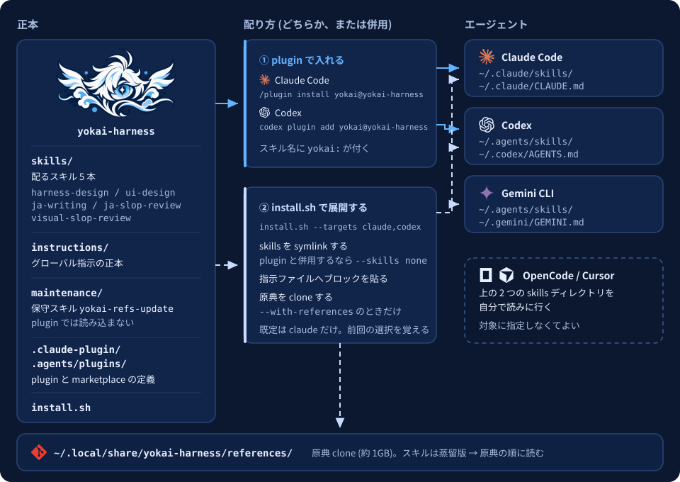

# yokai-harness

<p align="center">
  
</p>

コーディングエージェントに持たせる、参照資料とレビュー手順のスキル集。Claude Code・Codex・Gemini CLI で同じスキルを使える。



## 収録スキル

| スキル | 使う場面 |
|---|---|
| `harness-design` | CLAUDE.md・AGENTS.md・skills・hooks、プロンプト、エージェント構成を設計するとき |
| `ui-design` | UI のデザイン言語・デザイントークン・日本語の組版と図解を決めるとき |
| `ja-writing` | 日本語文書の表記規約・文書種別ごとの構成・textlint 規則を決めるとき |
| `ja-slop-review` | 日本語の文章から AI 臭を除くとき |
| `visual-slop-review` | Web UI・スライド・図解・生成画像の AI 臭を点検するとき |

上の 3 本は参照資料のスキルで、要点をまとめた蒸留版を先に読み、必要な箇所だけ原典を開く。仕組みは [docs/references.md](docs/references.md)。

## 入れ方

スキルだけ使うなら plugin で入れる。

```text
# Claude Code
/plugin marketplace add ystk-kai/yokai-harness
/plugin install yokai@yokai-harness
```

```bash
# Codex
codex plugin marketplace add ystk-kai/yokai-harness
codex plugin add yokai@yokai-harness
```

原典 clone とグローバル指示まで揃えるなら `install.sh` を使う。既定は Claude Code だけで、`--targets` で増やせる。

```bash
git clone https://github.com/ystk-kai/yokai-harness.git ~/yokai-harness
~/yokai-harness/install.sh --targets claude,codex --with-references
```

オプション、エージェントごとの展開先、plugin との併用は [docs/install.md](docs/install.md) にある。

## ドキュメント

| 文書 | 内容 |
|---|---|
| [docs/install.md](docs/install.md) | 導入の詳細。オプション、展開先、`install.sh` がすること・しないこと |
| [docs/references.md](docs/references.md) | 参照資料の 2 層構成、鮮度チェック、更新の手順 |
| [docs/development.md](docs/development.md) | 命名規則、スキルの増やし方、設計の判断、図の作り直し方 |

## ライセンス

MIT ([LICENSE](LICENSE))。蒸留版は第三者の原典を要約したもので、原典ごとのライセンスと扱いは [THIRD_PARTY_NOTICES.md](THIRD_PARTY_NOTICES.md) にまとめた。
