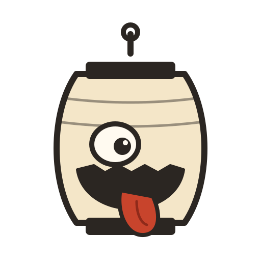
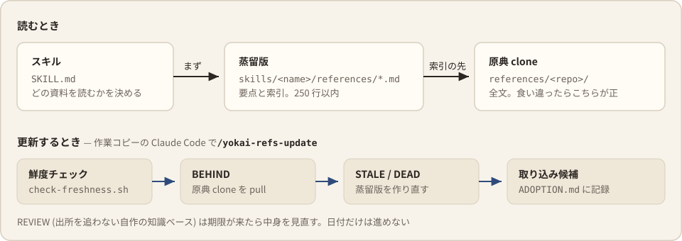

<p align="center">
  
</p>

<h1 align="center">yokai-harness</h1>

<p align="center">
  コーディングエージェントに持たせる個人ハーネス。<br>
  参照資料のスキルとグローバル指示を 1 つのリポジトリで管理し、Claude Code・Codex・Gemini CLI へ配る。
</p>


## 収録スキル

配るスキルは [Agent Skills](https://agentskills.io/specification) の形式で書いてあり、仕様にあるフィールドしか使っていない。どのエージェントでも同じものが動く。

| スキル | 種類 | 用途 |
|---|---|---|
| `harness-design` | 参照資料 | ハーネス (CLAUDE.md / AGENTS.md / skills / hooks など) とプロンプト、エージェント構成の設計。原典 8 本。採録した単発の手法は `PATTERNS.md` |
| `ui-design` | 参照資料 | UI のデザイン言語・DESIGN.md 雛形・デザイントークン・日本語の組版と図解。原典 4 本 + 自作の知識ベース |
| `ja-writing` | 参照資料 | 日本語文書の表記規約・文書種別ごとの構成・textlint 規則・AI 臭の規則の出所。原典 7 本 |
| `ja-slop-review` | レビュー手順 | 日本語の文章から AI 臭を除くレビューと書き直し |
| `visual-slop-review` | レビュー手順 | Web UI・スライド・図解・生成画像の AI 臭の検出と処方 |

保守用に `yokai-refs-update` (参照資料の鮮度チェックと再蒸留) がある。このリポジトリの作業コピーを書き換えるスキルなので、`skills/` の外の `maintenance/` に置いている。plugin のキャッシュにはリポジトリごとコピーされるが、スキルとしては読み込まれない。`install.sh` で Claude Code にだけ入り、`/yokai-refs-update` で呼ぶ。

## 導入

入れ方は 2 つある。スキルだけ欲しいなら plugin、原典 clone やグローバル指示まで揃えるなら `install.sh`。両方を使うときは、スキルの二重登録を避けるために `install.sh --skills none` にする。

### plugin で入れる

Claude Code:

```text
/plugin marketplace add ystk-kai/yokai-harness
/plugin install yokai@yokai-harness
```

Codex:

```bash
codex plugin marketplace add ystk-kai/yokai-harness
codex plugin add yokai@yokai-harness
```

plugin で入れたスキルは名前空間に入り、`yokai:harness-design` のように呼ばれる。Codex は `install.sh` の symlink 経由でも、リポジトリ直下の `plugin.json` を見て同じ名前で並べる。plugin はスキルしか運ばない。原典 clone とグローバル指示が要るなら、続けて `install.sh --skills none --with-references` を実行する。

### install.sh で展開する

前提は git と bash。

```bash
git clone https://github.com/ystk-kai/yokai-harness.git ~/yokai-harness
~/yokai-harness/install.sh --targets claude,codex --with-references
```

| オプション | 意味 |
|---|---|
| `--targets <list>` | 展開先。`claude` / `codex` / `gemini` をカンマで並べる。`auto` は前回の値に PATH にある CLI を足す (減らさない)。省略すると前回の値。前回の記録が無ければ、指示ファイルに残ったブロックから推定し、それも無ければ `claude` だけ。減らすときは明示して指定する |
| `--skills link` / `none` | `link` (既定) は skills を symlink する。plugin と併用するときは `none` |
| `--with-references` | 原典を clone する (合計 1GB 超。最大は `smarthr-design-system` の約 750MB)。外しても蒸留版だけでスキルは動くが、索引から原典を開く経路が使えない |

選んだ対象とスキルの入れ方は `~/.local/state/yokai-harness/install.conf` に残り、次の実行で引き継ぐ。Claude Code だけを使う環境では、オプションなしで実行すれば Claude 以外には何も書かない。

エージェントごとの展開先:

| 対象 | skills | グローバル指示 | ほかに入るもの |
|---|---|---|---|
| `claude` | `${CLAUDE_CONFIG_DIR:-~/.claude}/skills/` | `~/.claude/CLAUDE.md` | 保守スキル、`settings/global.json` のマージ |
| `codex` | `~/.agents/skills/` | `${CODEX_HOME:-~/.codex}/AGENTS.md` | — |
| `gemini` | `~/.agents/skills/` | `~/.gemini/GEMINI.md` | — |

OpenCode と Cursor は対象に入れなくてよい。どちらも `~/.claude/skills/` と `~/.agents/skills/` を自分で読み、OpenCode は自前の AGENTS.md が無ければ `~/.claude/CLAUDE.md` も読む。そのため `claude` と `codex` (か `gemini`) を両方選ぶと、この 2 つには同じスキルが 2 か所から見える。OpenCode の公式ドキュメントは、スキル名をすべての置き場で一意にするよう求めている。OpenCode は `OPENCODE_DISABLE_CLAUDE_CODE_SKILLS=1` で `~/.claude/skills/` 側を止められる。Cursor での見え方は確かめていない。

### エージェントに任せる

新しい環境のエージェントに次を貼ると、clone から検証まで進めてくれる。

```text
https://github.com/ystk-kai/yokai-harness を ~/yokai-harness に clone し、
~/yokai-harness/install.sh --targets auto --with-references を実行してください。
完了後に次の 3 点を確かめて報告してください:
1. 選ばれた対象の skills ディレクトリに、~/yokai-harness/skills/ の各スキルへの symlink があること
2. 選ばれた対象の指示ファイルに <!-- BEGIN yokai-harness:reference-routing --> のブロックがあること
3. bash ~/yokai-harness/scripts/check-freshness.sh --offline の出力に MISS と ERR が無いこと
   (clone した直後は原典が蒸留時より進んでいて STALE が出ることがある。それは更新待ちで、導入の失敗ではない)
```

## install.sh がすること

何度実行しても同じ状態に収束する。手で書いた部分と、ほかのツールが置いたものには触らない。

1. **skills を symlink する** — `skills/*/` を対象の skills ディレクトリへ張る。同じ名前で実体や、ほかの場所を指す symlink が置かれていたら、上書きせずにスキップする。刈るのは、このリポジトリ (か改名前の claude-harness) が張ったと分かる symlink のうち、消えたスキル・旧名・対象から外したエージェントの分だけ。リンク名とリンク先の名前が違うもの (自分で付けた別名など) には触らない
2. **指示ファイルにブロックを貼る** — `instructions/<name>.md` を `<!-- BEGIN yokai-harness:<name> -->` 〜 `<!-- END yokai-harness:<name> -->` で囲み、対象の指示ファイルの末尾に貼る。先に yokai-harness のブロックを全部剥がしてから貼り直すので、消えた instructions のブロックも残らない。BEGIN と END の対応が崩れていたら、何も書かずに中断する
3. **settings.json にキーをマージする (claude のみ)** — `settings/global.json` をローカルに置いた環境だけで動く。この repo は payload を同梱しない (有効プラグインや marketplace の一覧は個人環境の情報なので)。`jq` が要る
4. **原典を clone する (`--with-references`)** — 蒸留版の frontmatter の `source` から `~/.local/share/yokai-harness/references/<repo>/` へ `git clone --filter=blob:none` する。原典に入っている `.claude/skills` は sparse-checkout で worktree から外す。原典を置いただけで第三者のスキルがディレクトリスコープで自動登録されるのを防ぐため

書き換える前の指示ファイルと settings.json は、`<元の名前>.pre-yokai-harness.<日時>.bak` に残す。前の世代は上書きしない。

書き込む前に、全部の指示ファイルの marker を検査する。対象の指示ファイルで BEGIN と END の対応が崩れていたら、どのファイルも書き換えずに止まる。コードフェンスの中に書いた marker の行は、手書きの説明として扱って触らない。選んだ対象の記録は、全部を適用し終えてから保存する。

旧版 (claude-harness) からの移行も同じ実行で済む。`~/.claude/references/` の実体を新しい置き場へ移し、旧パスには移行用の symlink を残す。旧名のスキルの symlink と旧形式の `managed:harness-design` ブロックは掃除する。

### 管理しないもの

`~/.claude` や `~/.codex` を丸ごと再現するツールではない。次のものは意図して対象から外している。

- **permissions と sandbox 系の設定** — 環境ごとに違ってよく、repo が上書きすると権限昇格の事故につながる
- **effortLevel・theme・model などの個人設定** — マシンごとに変えたいもの
- **agents・memory・tasks** — 個人の状態や、プロジェクトをまたぐ調整に使うもの
- **この repo が置いていないスキル** — 実体で置いたスキルや、ほかの marketplace から入れたスキルには触らない

## 参照資料の 2 層構成



- **蒸留版** — `skills/{harness-design,ui-design,ja-writing}/references/*.md`。要点と索引を 250 行以内にまとめたもの。frontmatter の `source` が原典の URL の唯一の正で、`distilled_commit` が蒸留した時点の SHA
- **原典** — `$YOKAI_HARNESS_REFS` (既定 `~/.local/share/yokai-harness/references/<repo>/`)。全文。蒸留版と食い違ったら原典が正

鮮度チェックは `bash scripts/check-freshness.sh`。1 ファイル 1 行で、行頭のタグが次にやることを示す。

| タグ | 状態 | やること |
|---|---|---|
| `BEHIND` | clone が upstream より古い | pull する |
| `STALE` | 蒸留版が clone より古い | 再蒸留する |
| `REVIEW` | 出所 clone を持たない知識ベースの棚卸し期限切れ | 中身を見直す |
| `DEAD` | 蒸留版の索引が指す原典ファイルが clone の HEAD に無い | 索引を直す |
| `OK` / `MISS` / `ERR` / `NOTE` | 最新 / clone が無い / frontmatter か SHA が解決できない / 判定できなかった | — |

要対応があれば exit 1 を返す。`--offline` で fetch を省く。BEHIND と STALE が同時に立つ repo は pull が先なので、`BEHIND` 行だけが出る。

`skills/*/references/*.md` の frontmatter は次の 3 形式のどれかを取る。どれでもないものは `ERR` にする。frontmatter が無いだけで黙って対象外にすると、意図した非追従と壊れた蒸留版の区別がつかなくなるため。

| 形式 | キー | 用途 |
|---|---|---|
| 蒸留版 | `source` + `distilled_commit` + `distilled_at` | 原典 clone を SHA で追従する |
| 知識ベース | `tracking: review` + `reviewed_at` + `review_interval_days` | 出所 clone を持たない自作の調査資料 (`*-slop-review` の references) |
| 対象外 | `tracking: none` | 鮮度管理しないと明示するもの |

チェックから更新まで一括で回すなら、作業コピーを展開した Claude Code で `/yokai-refs-update` を実行する。鮮度チェック → BEHIND の pull → STALE の再蒸留 → REVIEW の棚卸し → 取り込み候補の照合の順に進む。`--check` でチェックだけ、repo 名を渡すとその repo だけを対象にする。

蒸留版の SHA を進めても、このハーネス自体は自動では直らない。そこで再蒸留した各サブエージェントが、取り込み候補を `BREAKING` (今の書き方が壊れている) / `RECOMMENDED` / `FYI` の 3 段で返す。候補は実際のハーネスに grep で当ててから [ADOPTION.md](maintenance/yokai-refs-update/ADOPTION.md) に記録する。当たらなかったものも、却下の理由を付けて `FYI` で残す。消すと、同じ候補が毎回上がってくる。

参照リポジトリを増やすときは、蒸留版を `skills/<skill>/references/<clone ディレクトリ名>.md` として 1 ファイル作り、そのスキルの SKILL.md の表に行を足す。`check-freshness.sh` と `install.sh` はどちらも `skills/*/references/*.md` をスキル横断で見るので、置き場所が合っていれば自動で対象になる。規約は [DISTILLING.md](maintenance/yokai-refs-update/DISTILLING.md)。

継続して追うほどではない資料 (探索索引の先・記事・論文・製品リポジトリ) から単発の手法だけ採るときは、蒸留版を作らず [PATTERNS.md](skills/harness-design/PATTERNS.md) に 1 項目 = 1 手法 + 出所 1 行で足す。採録の条件と退出の規約は同ファイルが持つ。

## 命名規則

| 対象 | 規則 | 例 |
|---|---|---|
| リポジトリ・marketplace | `yokai-harness` | `yokai@yokai-harness` |
| plugin | `yokai`。スキルの名前空間になる | `yokai:ui-design` |
| 配るスキル | `<領域>-<役割>`。領域は `harness` / `ui` / `ja` / `visual`、役割は参照資料なら `design` / `writing`、レビュー手順なら `slop-review`。名前空間は plugin が付けるので、スキル名には `yokai` を入れない | `ja-writing`, `ja-slop-review` |
| 保守スキル | `yokai-<動作>`。plugin の外で symlink され名前空間を持たないので、`yokai-` で始めて出所を示す | `yokai-refs-update` |
| グローバル指示 | `instructions/<中身>.md`。ファイル名がブロック名になる | `reference-routing` → `yokai-harness:reference-routing` |
| 環境変数・置き場 | `YOKAI_HARNESS_*`、XDG のディレクトリの下の `yokai-harness/` | `YOKAI_HARNESS_REFS`, `~/.local/state/yokai-harness/` |

スキル名は Agent Skills 仕様に従い、英小文字・数字・ハイフンで 64 字まで、ディレクトリ名と一致させる。

## スキルを増やす・外す

増やすとき:

1. `skills/<name>/SKILL.md` を書く。frontmatter は Agent Skills 仕様の 6 フィールド (`name` / `description` / `license` / `compatibility` / `metadata` / `allowed-tools`) に限る。Claude Code だけのフィールドはほかのエージェントでは効かず、claude.ai への upload では弾かれる
2. 外部の状態に頼らず、`references/` で自己完結させる。避けられない外部依存は `compatibility` に書く
3. 常時ルールにしたいものだけ `instructions/<name>.md` を足す
4. `install.sh` を再実行する。plugin の利用者に届けるには、`plugin.json` の `version` も上げる。Codex の利用者は `codex plugin add yokai@yokai-harness` を実行し直すと新しい内容を受け取る

外すとき・改名するときは、ディレクトリを消すか `git mv` してから `install.sh` を再実行する。古い symlink とブロックは `install.sh` が刈る。改名したら、命名規則の表と、スキル名を書いている箇所 (`instructions/`・各 SKILL.md の相互参照) も直す。

## 設計メモ

### 原典 clone をスキルの外に置く

Agent Skills 仕様の `references/` は、そのスキルのために書いた文書を置く場所になっている。ここで扱う原典は外部リポジトリの丸ごとの clone (合計 1GB 超・第三者のライセンス・`git pull` で独立に更新) で、性質が違う。

- 外部 clone は共有コーパスとして `~/.local/share/yokai-harness/references/` に置く。スキルや plugin に第三者のリポジトリを同梱せずに済み、どのエージェントからも同じ場所を読める。特定のエージェントの設定ディレクトリに置かないのは、そのエージェントを使わない環境にまで設定ディレクトリを作らないため
- スキルの外への依存は、SKILL.md の `compatibility` に書く
- 自作の蒸留資料は `skills/<skill>/references/` に置き、SKILL.md から 1 階層でリンクする。ふだんは蒸留版で足り、原典の全文を読みにいく入力トークンを抑えられる
- 原典と 1 対 1 に対応しない自作文書 (`PATTERNS.md` など) は `references/` に入れず、スキルの直下に置く。`references/` を蒸留版だけの場所に保ち、「frontmatter の `source` が repo リストの唯一の正」という規約を崩さないため

### グローバル指示は import でなく書き写す

1 つの AGENTS.md を各エージェントから import する形も取れる。ただし Claude Code は Cowork のセッションでユーザー単位の指示ファイルから作業ディレクトリ外への import を飛ばし、Codex の公式ドキュメントには import の記述が無い。どのエージェントでも確実に効く形として、同じ中身を各指示ファイルへ managed ブロックで書き写している。

### plugin に入れるものと入れないもの

plugin はインストール時にキャッシュへコピーされ、更新のたびに置き場所が変わる。plugin 直下の CLAUDE.md も読まれない。そのため plugin で読み込ませるのはスキルだけにし、作業コピーを書き換える保守スキルと、原典 clone・グローバル指示は `install.sh` の担当にしている。plugin の source はリポジトリ直下 (`./`) なので、`maintenance/` や `install.sh` もキャッシュにコピーされる。読み込まれるのは `skills/` だけ。同じ理由で、Codex の marketplace を `--sparse` で追加すると plugin 本体が欠ける。

Claude Code 用の `.claude-plugin/plugin.json` には `version` を書いていない。書くと利用者がその版に留まり、蒸留版の更新が届かなくなるため。Codex 用の `plugin.json` には `version` を書いている。codex-cli 0.165 は version ごとにキャッシュを分け、書かないと `1.0.0` 扱いになった。ただし同じ version のままでも、`codex plugin add` を実行し直せば中身は上書きされる。公式ドキュメントにはローカルの plugin の version は `local` とあり、手元の挙動と食い違っている。

### 図とロゴ

図は `assets/src/` の SVG が原稿で、`assets/build.py` が図に出てくる字だけを Noto Sans JP から切り出して埋め込む。GitHub の閲覧環境に日本語フォントがあるとは限らないため。フォントのライセンス (SIL OFL 1.1) は [assets/fonts/OFL.txt](assets/fonts/OFL.txt)。図を直したら次で作り直す。

```bash
curl -L -o NotoSansJP.ttf 'https://github.com/google/fonts/raw/main/ofl/notosansjp/NotoSansJP%5Bwght%5D.ttf'
python3 assets/build.py NotoSansJP.ttf
```

各社のロゴは商標なので図に使わず、名前で示している。

## ライセンス

MIT ([LICENSE](LICENSE))。蒸留版は第三者の原典を要約したもので、原典ごとのライセンスと扱い (`12-factor-agents` の蒸留版は CC BY-SA 4.0) は [THIRD_PARTY_NOTICES.md](THIRD_PARTY_NOTICES.md) にまとめた。図に埋め込んだ Noto Sans JP は SIL OFL 1.1。
