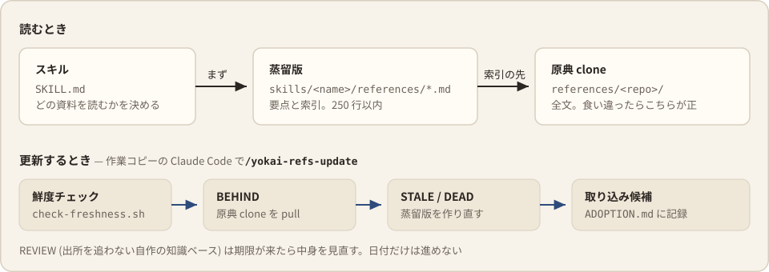

# 参照資料の 2 層構成

スキルが読む資料は 2 層に分けてある。ふだんは短い蒸留版で足り、原典の全文は必要な箇所だけ開く。

## 2 つの層

- **蒸留版** — `skills/{harness-design,ui-design,ja-writing}/references/*.md`。要点と索引を 250 行以内にまとめたもの。frontmatter の `source` が原典の URL の唯一の正で、`distilled_commit` が蒸留した時点の SHA
- **原典** — `$YOKAI_HARNESS_REFS` (既定 `~/.local/share/yokai-harness/references/<repo>/`)。全文。蒸留版と食い違ったら原典が正

## 鮮度チェック

鮮度チェックは `bash scripts/check-freshness.sh`。1 ファイル 1 行で、行頭のタグが次にやることを示す。

| タグ | 状態 | やること |
|---|---|---|
| `BEHIND` | clone が upstream より古い | pull する |
| `STALE` | 蒸留版が clone より古い | 再蒸留する |
| `REVIEW` | 出所 clone を持たない知識ベースの棚卸し期限切れ | 中身を見直す |
| `DEAD` | 蒸留版の索引が指す原典ファイルが clone の HEAD に無い | 索引を直す |
| `OK` / `MISS` / `ERR` / `NOTE` | 最新 / clone が無い / frontmatter か SHA が解決できない / 判定できなかった | — |

要対応があれば exit 1 を返す。`--offline` で fetch を省く。BEHIND と STALE が同時に立つ repo は pull が先なので、`BEHIND` 行だけが出る。

`skills/*/references/*.md` の frontmatter は次の 3 形式のどれかを取る。どれでもないものは `ERR` にする。frontmatter が無いだけで黙って対象外にすると、意図した非追従と壊れた蒸留版の区別がつかなくなるため。

| 形式 | キー | 用途 |
|---|---|---|
| 蒸留版 | `source` + `distilled_commit` + `distilled_at` | 原典 clone を SHA で追従する |
| 知識ベース | `tracking: review` + `reviewed_at` + `review_interval_days` | 出所 clone を持たない自作の調査資料 (`*-slop-review` の references) |
| 対象外 | `tracking: none` | 鮮度管理しないと明示するもの |

## 更新する

チェックから更新まで一括で回すなら、作業コピーを展開した Claude Code で `/yokai-refs-update` を実行する。鮮度チェック → BEHIND の pull → STALE の再蒸留 → REVIEW の棚卸し → 取り込み候補の照合の順に進む。`--check` でチェックだけ、repo 名を渡すとその repo だけを対象にする。

蒸留版の SHA を進めても、このハーネス自体は自動では直らない。そこで再蒸留した各サブエージェントが、取り込み候補を `BREAKING` (今の書き方が壊れている) / `RECOMMENDED` / `FYI` の 3 段で返す。候補は実際のハーネスに grep で当ててから [ADOPTION.md](../maintenance/yokai-refs-update/ADOPTION.md) に記録する。当たらなかったものも、却下の理由を付けて `FYI` で残す。消すと、同じ候補が毎回上がってくる。

## 参照リポジトリを増やす

参照リポジトリを増やすときは、蒸留版を `skills/<skill>/references/<clone ディレクトリ名>.md` として 1 ファイル作り、そのスキルの SKILL.md の表に行を足す。`check-freshness.sh` と `install.sh` はどちらも `skills/*/references/*.md` をスキル横断で見るので、置き場所が合っていれば自動で対象になる。規約は [DISTILLING.md](../maintenance/yokai-refs-update/DISTILLING.md)。

継続して追うほどではない資料 (探索索引の先・記事・論文・製品リポジトリ) から単発の手法だけ採るときは、蒸留版を作らず [PATTERNS.md](../skills/harness-design/PATTERNS.md) に 1 項目 = 1 手法 + 出所 1 行で足す。採録の条件と退出の規約は同ファイルが持つ。
